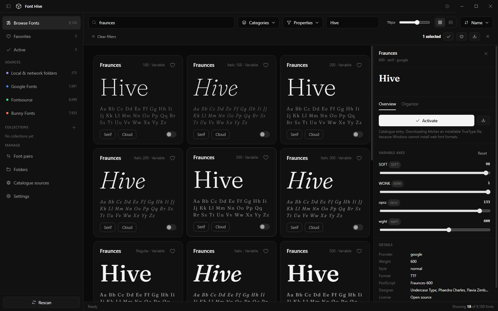

# Font Hive

A free, open-source font manager for Windows. Indexes every font on the machine
alongside downloadable catalogues, renders live previews, installs and removes
fonts from the OS, and organises everything with collections and smart filters.

**[Download the latest Windows installer](https://github.com/NitishMPD/FontHive/releases/latest)**
(Windows 10/11, x64). The installer is not code-signed, so Windows SmartScreen
may show a warning on first run: choose **More info → Run anyway**. After the
first install, updates arrive inside the app.



Built with Tauri 2, Rust, React and TypeScript. Font parsing uses `ttf-parser`
and `wuff`; Windows renders the UI through the shared Evergreen WebView2 runtime.

## Features

**Library**
- Recursive scanning of system font directories plus any folders you add, including network shares
- Watched folders are re-scanned in the background on launch, so newly added fonts appear
  without a manual refresh; removing a folder also removes the faces it contributed
- Catalogue fetches are de-duplicated, so families listed twice under different slugs
  or types cannot produce duplicate library entries
- TrueType collections (`.ttc`/`.otc`) are expanded into their individual faces
- Category classification from the font's PANOSE record, not just its name
- Virtualised grid, so tens of thousands of faces stay smooth
- Live preview text, adjustable size and column count

**Search**
- Instant substring matching across family, style and tags
- Typo-tolerant fallback, so a misspelling like `Giest` still finds `Geist` —
  including transposed letters, which plain substring search cannot catch
- The fallback only engages when exact matching finds nothing, so precise
  searches stay precise, and the status bar marks the result `fuzzy match` so a
  near-miss is never mistaken for an exact hit
- Terms of three characters or fewer are never fuzzied, since nearly everything
  would match

**Providers** — catalogue sources you can browse and download from

| Provider | Families | Notes |
| --- | --- | --- |
| Google Fonts | 1,950 | Catalogue from the public metadata endpoint |
| Bunny Fonts | 1,971 | Privacy-focused Google Fonts mirror |
| Fontsource | 2,103 | Open-source fonts served via jsDelivr |
| Local & network folders | — | Your own collections |

Catalogue faces preview instantly through the provider's CSS endpoint without
downloading anything. Downloading fetches an installable file into the local
cache.

**Activation**
- Per-user install into the Windows font store, registered under
  `HKCU\SOFTWARE\Microsoft\Windows NT\CurrentVersion\Fonts`
- Running applications are notified immediately via `AddFontResourceW` and a
  `WM_FONTCHANGE` broadcast, so no reboot or sign-out is needed
- Deactivation removes the registry entry and the installed file
- Activation state is reconciled against the registry on every launch

**Controls**
- Variable font axes driven by sliders, applied live to the preview
- Collections, both manual and rule-based ("smart") with `all`/`any` matching
- Font pairs: heading + body combinations ranked on role contrast, weight
  separation and measured x-height harmony, each showing why it was suggested
- Tags, 1–5 star ratings and free-text notes per face
- Filters for category, provider, active state, downloaded state and variability

## Why downloads are always TTF or OTF

Web font formats (`.woff`, `.woff2`) cannot be installed as system fonts by
Windows. Catalogue previews therefore use whatever format the provider serves,
but any download resolves to an installable TrueType/OpenType file. Fontsource
is preferred as a download source because it publishes stable `.ttf` paths; the
Google legacy endpoint is the fallback.

## Getting started

Requires Windows 10/11 x64, Node.js, pnpm, Rust 1.90 or newer, and Visual Studio
C++ Build Tools with a Windows SDK. WebView2 is required to run the application.

Project commands include the standard Rust installation (`%USERPROFILE%/.cargo/bin`
or `CARGO_HOME/bin`) in their child-process PATH, including terminals opened before
Rust was installed. If compilation reports missing `link.exe` or `cl.exe`, install
Visual Studio Build Tools with the **Desktop development with C++** workload and
a Windows SDK, then use its Developer PowerShell. Rust alone does not include
Microsoft's C++ toolchain.

```powershell
pnpm install --frozen-lockfile
pnpm dev             # Tauri app with Vite hot reload
pnpm typecheck       # TypeScript checks
pnpm check:rust      # Rust type check
pnpm test:rust       # Rust unit tests
pnpm check:scroll    # deferred font preview behavior
pnpm check:fuzzy     # search behavior and performance
pnpm check:updates   # release versions and Tauri updater manifest
pnpm check:providers # live catalogues, installable downloads and variable WOFF2
```

## Windows releases

Run `pnpm dist:win` to package a Windows x64 NSIS installer. Output is under
`src-tauri/target/x86_64-pc-windows-msvc/release/bundle/nsis/`. Tauri uses the
shared Evergreen WebView2 runtime to keep the installer small; setup downloads
WebView2 if it is missing, which requires an internet connection.

The installer remains unsigned for Windows publisher identity, so SmartScreen
may still warn. Tauri updater signatures are separate from Authenticode signing.
Installer publisher metadata is **Nitish**; the verified Windows signer name
requires a matching code-signing certificate.

Pushes to `master` or `main` run checks, generate a stable version from the
base version plus workflow run number, build the installer, and upload the
installer, signature and `tauri-latest.json` to a draft GitHub Release before
publishing it. A failed check, build or signing step prevents publication.
The workflow uses GitHub's built-in token with `contents: write` permission.

### Updater signing setup

The initial signing key is stored locally at `.keys/tauri-updater.key`, which
is ignored by git. Back it up securely. Its matching public key is in
`src-tauri/tauri.conf.json`. Add the private key contents as the GitHub Actions
secret `TAURI_SIGNING_PRIVATE_KEY`; add `TAURI_SIGNING_PRIVATE_KEY_PASSWORD`
if using an encrypted key. Never commit a private key or generate a new key
for each release. The initial local key uses an empty password; project commands
pass that explicitly so signing does not prompt. If you replace it with an
encrypted key, set `TAURI_SIGNING_PRIVATE_KEY_PASSWORD` to its password.
To upload the existing private key without copying or reformatting it, run from
the project root with an authenticated GitHub CLI:

```powershell
Get-Content -Raw .keys/tauri-updater.key | gh secret set TAURI_SIGNING_PRIVATE_KEY --repo NitishMPD/FontHive
```

The secret must contain the entire file, including base64 padding, without extra
quotes or encoding. A path such as `.keys/tauri-updater.key` cannot resolve on the
GitHub runner. An `Invalid padding` error after installer creation indicates
invalid key encoding; replacing the secret with the unchanged file contents
addresses that input error. Preserve the existing key pair.
The workflow checks signing on a temporary file before compilation and stops
early for missing/invalid keys or an incorrect password, without logging secrets.
After correcting the secret, rerun the failed GitHub Actions job.

For a local signed package:

```powershell
$env:TAURI_SIGNING_PRIVATE_KEY = Get-Content -Raw .keys/tauri-updater.key
pnpm dist:win
```

### Migrating from Electron

Close and uninstall the old Electron app, which preserves your library data,
then install the Tauri release manually. Electron's updater feed cannot install
the new Tauri package. Do not run both versions at the same time.

The Tauri app keeps `%APPDATA%/font-hive` and stable font IDs. On first open,
it copies existing `library.json` and `activated.json` to corresponding
`.pre-tauri` backups before reading them. Collections, pairs, ratings, tags,
notes, favorites, downloaded fonts and activation mappings remain in place.
Window-local theme/sidebar preferences may reset because WebView2 uses a new
browser profile. Keep the old installer and backups until migration is verified.

### In-app updates

The installed app checks ten seconds after launch and every six hours. The title
bar and **Settings > App updates** offer release notes, download progress, and
**Restart and install**. Installation waits for library operations to finish and
saves before restarting. Failed preparation keeps the downloaded update for a
retry. Ordinary app quit never installs an update; development mode never checks.

### Verification before release

Run `pnpm dist:win`, then manually verify fresh installation, an Electron data
migration, previewing TTF/OTF/TTC/WOFF/WOFF2 and variable fonts, activation in
another running application, network folders, keyboard/window controls and an
update between two signed versions. Installer size and native behavior remain
unverified until those checks run.

## Layout

- `src-tauri/src/`: Rust lifecycle, library commands, storage, font parsing,
  Windows activation, provider networking and updater.
- `src-tauri/tauri.conf.json`: window, CSP, installer and updater settings.
- `src/renderer/src/lib/desktop.ts`: typed frontend command/event adapter.
- `src/renderer/src/`: existing React components, state and library logic.
- `src/shared/types.ts`: frontend API and record contracts.

Fonts are served through an ID-restricted `hive-font` protocol. The frontend
has no general filesystem, shell or HTTP plugin permission.

## Data locations

State stays in the original data directory (`%APPDATA%\font-hive`):

- `library.json` — the indexed library, collections, folders and settings
- `activated.json` — which faces are installed and where
- `font-cache/` — downloaded installable files

Deleting `library.json` forces a full re-index on next launch.
`schemaVersion` in that file invalidates derived fields when the classification
logic changes, re-indexing local faces automatically.

The reader tolerates a UTF-8 BOM, since editors, PowerShell redirection and
backup tools commonly add one and `JSON.parse` rejects it — without that, a
perfectly recoverable file would be quarantined. A file that is genuinely
unparseable is renamed to `library.json.corrupt-<timestamp>` and the app starts
with an empty library rather than failing to launch.

## Notes and limitations

- This Tauri release targets Windows x64. macOS and Linux installers and
  activation are not included.
- Google and Bunny serve static instances per weight, so a *downloaded* face has
  no variable axes even when the catalogue entry advertises them. Local variable
  fonts keep full axis control.
- Google, Bunny and Fontsource carry largely the same library — 25,065 records
  cover about 2,400 families, and 86% of faces are offered by more than one
  provider. The grid collapses identical faces to one card by default; toggle
  **Properties → Group duplicate sources** to see every record instead. Records
  are never deleted, so filtering by a source still lists exactly what that
  source offers.
- Fonts are analysed and stored locally. Catalogue requests go only to the
  provider endpoints listed above.

## License

[MIT](LICENSE)
